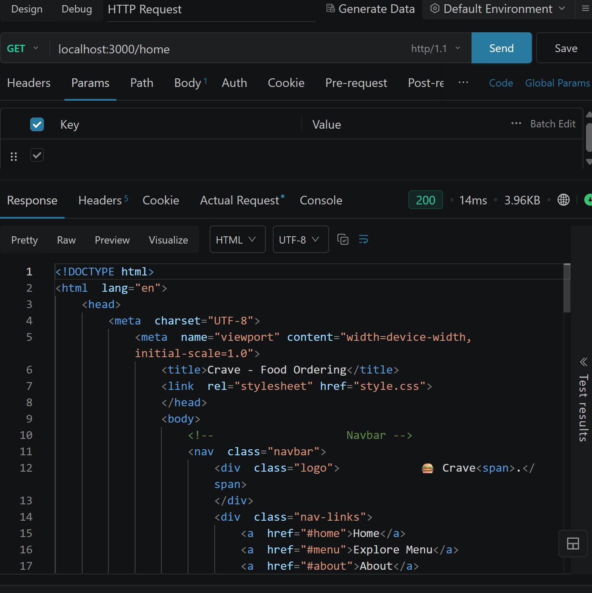
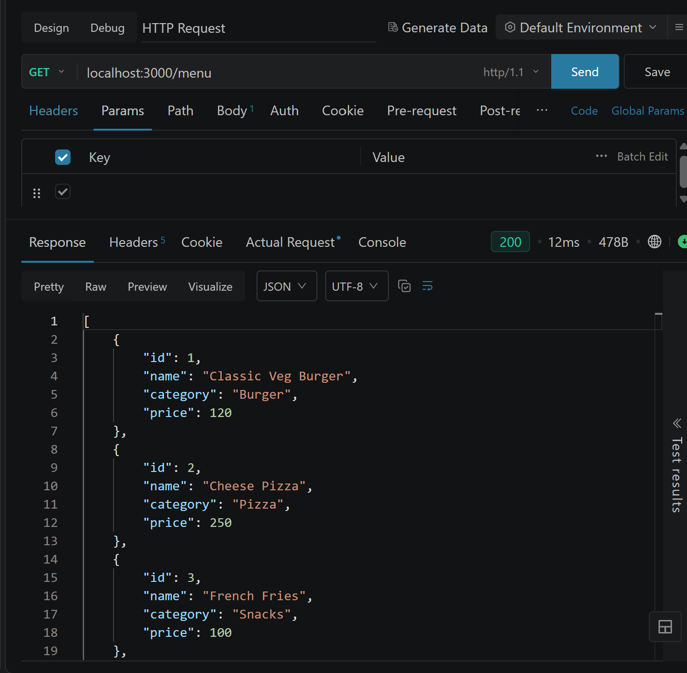
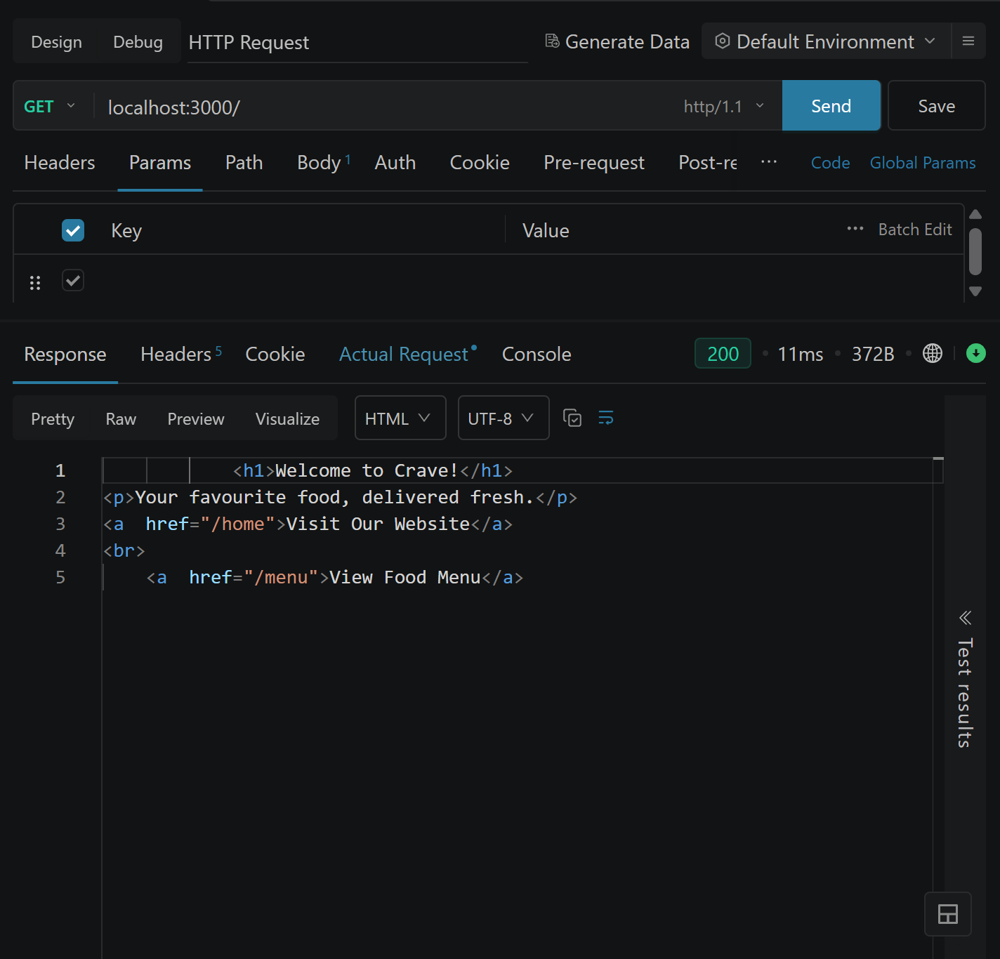
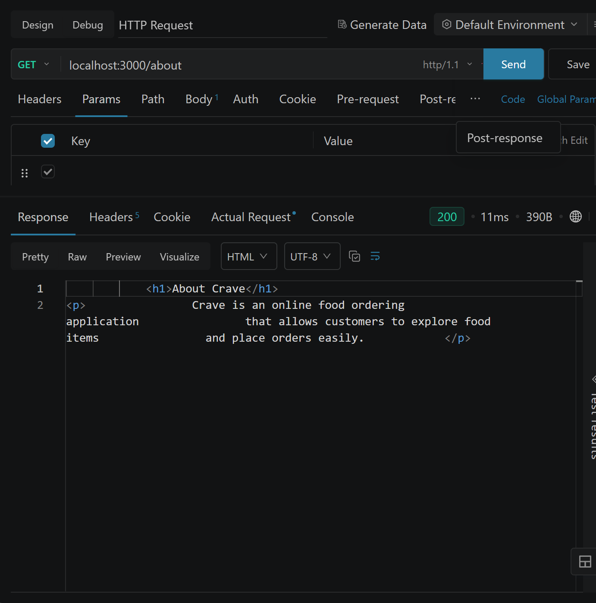
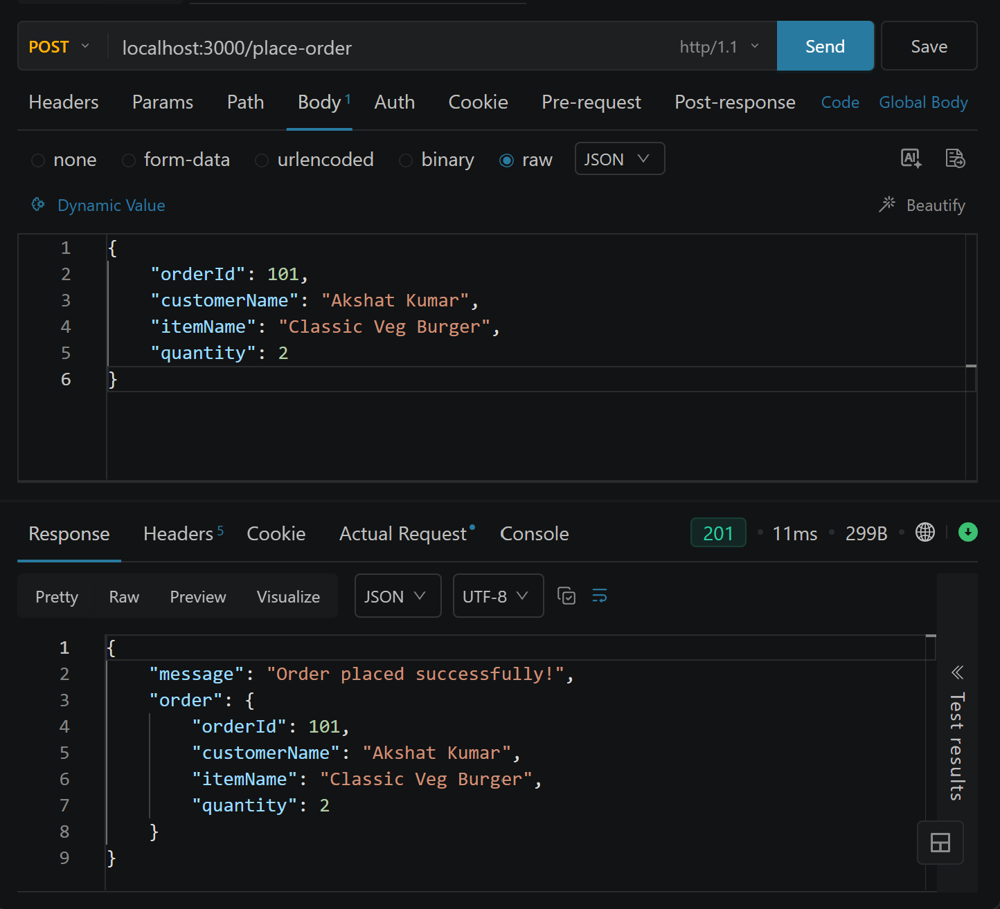
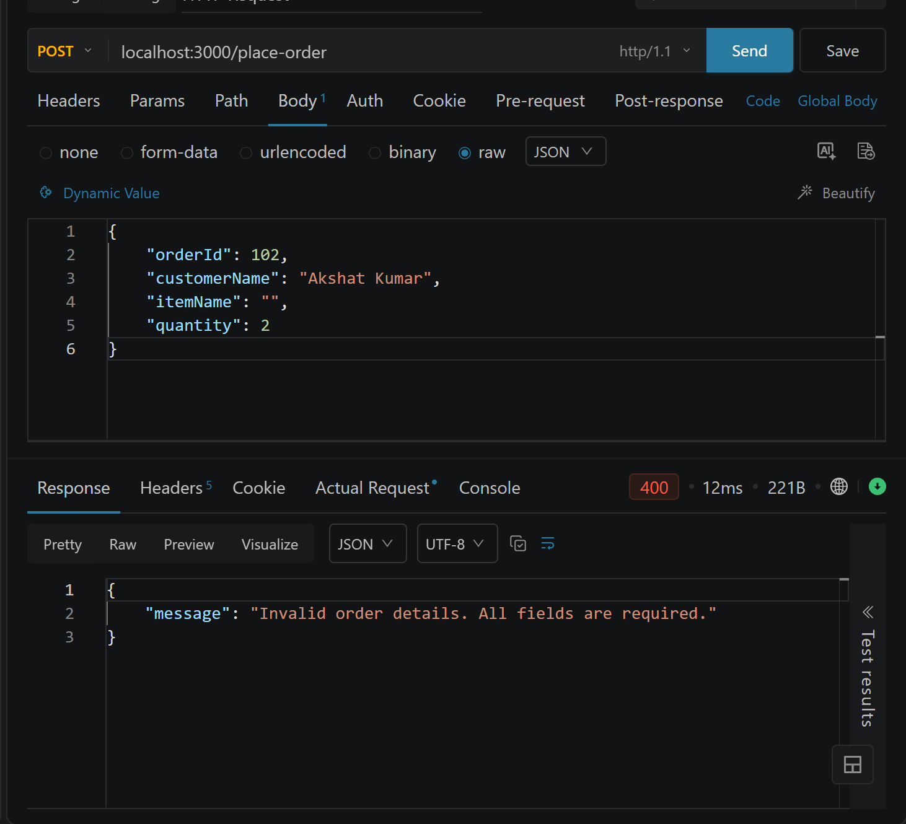

# 🍔 Crave — Food Ordering Web Application

### *Good food. Great mood. Delivered fresh.*

Crave is a modern food ordering web application built using **HTML, CSS, JavaScript, Node.js, and Express.js**. It combines a clean, premium-looking interface with a functional shopping cart and RESTful APIs for managing food orders.

Explore delicious meals, add your favourites to the cart, and place orders through a simple and interactive experience.

---

## ✨ Features

### 🎨 Premium User Interface
- Modern, responsive food ordering website.
- Smooth animations and transitions.
- Animated hero section and food cards.
- Scroll-reveal effects.
- Interactive hover effects.
- Premium toast notifications.

### 🛒 Shopping Experience
- Browse available food items.
- Search food items.
- Filter items by category.
- Add and remove items from cart.
- Increase or decrease item quantities.
- Automatic cart total calculation.
- Place orders directly through the website.

### ⚙️ Backend Functionality
- Custom HTTP server using Node.js.
- File serving using the built-in File System (`fs`) module.
- REST APIs using Express.js.
- Create, Read, Update and Delete (CRUD) operations.
- Order validation and error handling.
- In-memory order storage (no database required).

---

## 🛠️ Tech Stack

| Technology | Purpose |
|---|---|
| HTML5 | Website structure |
| CSS3 | Styling, animations and responsiveness |
| JavaScript | Frontend interactivity |
| Node.js | HTTP server and backend runtime |
| Express.js | REST API development |
| HTTP Module | Custom HTTP server |
| FS Module | Reading and serving files |

---

## 📂 Project Structure

```text
FoodApp/
│
├── public/
│   ├── index.html
│   ├── style.css
│   └── script.js
│
├── screenshots/
│   ├── home-page.png
│   ├── menu-page.png
│   ├── welcome.png
│   ├── about-page.png
│   ├── post-order-success.png
│   └── post-order-error.png
│
├── httpserver.js
├── expressApp.js
├── package.json
├── package-lock.json
└── .gitignore
```

---

## 🚀 Getting Started

Follow these steps to run Crave locally.

### 1. Clone the Repository

```bash
git clone <YOUR_GITHUB_REPOSITORY_URL>
```

### 2. Navigate to the Project

```bash
cd FoodApp
```

### 3. Install Dependencies

```bash
npm install
```

### 4. Start the Node.js HTTP Server

Open the first terminal:

```bash
node httpserver.js
```

Server runs at:

`http://localhost:3000`

### 5. Start the Express Server

Open a second terminal:

```bash
node expressApp.js
```

Server runs at:

`http://localhost:4000`

### 6. Open Crave

Visit:

`http://localhost:3000/home`

**Important:** Keep both servers running while using the application.

---

## 🔗 API Endpoints

Crave uses two backend servers.

### Part A — Node.js HTTP Server

Base URL: `http://localhost:3000`

| Method | Endpoint | Description |
|---|---|---|
| GET | `/` | Welcome page |
| GET | `/home` | Serve the main website |
| GET | `/menu` | Retrieve food menu |
| GET | `/about` | Application information |
| POST | `/place-order` | Place an order through the HTTP server |

### Part B — Express.js REST API

Base URL: `http://localhost:4000`

| Method | Endpoint | Description |
|---|---|---|
| GET | `/orders` | Retrieve all orders |
| GET | `/orders/:id` | Retrieve a specific order |
| POST | `/orders` | Create a new order |
| PUT | `/orders/:id` | Update an existing order |
| DELETE | `/orders/:id` | Delete an order |

### Sample Order JSON

```json
{
  "orderId": 4,
  "customerName": "Neha Verma",
  "itemName": "Paneer Pizza",
  "quantity": 1,
  "status": "Pending",
  "totalAmount": 350
}
```

---

## 📸 Screenshots

### Homepage


### Food Menu


### Server Welcome Page


### About Crave


### Order Placement — Success


### Order Placement — Error Handling


---

## ⚠️ Important Notes

- Orders are stored in JavaScript arrays in memory.
- No database is connected to this project.
- Order data resets when the Express server restarts.
- The frontend communicates with the Express API through configured CORS headers.
- Both servers must be running for website checkout functionality.

---

## 🎯 Learning Objectives

This project demonstrates practical implementation of:

- Node.js HTTP server creation.
- File System module and file handling.
- HTTP methods and routing.
- Express.js middleware.
- RESTful API development.
- CRUD operations.
- JSON data handling.
- Input validation and error handling.
- Frontend and backend communication.

---

## 👨‍💻 Developer

**Akshat Kumar**

B.Tech — Computer Science & Engineering

Built as part of the Full Stack Development — Node.js Lab Examination.

---

### 🍔 Crave

*From cravings to comfort — one order at a time.*